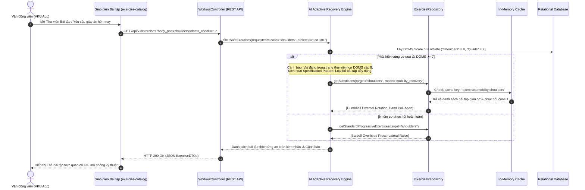
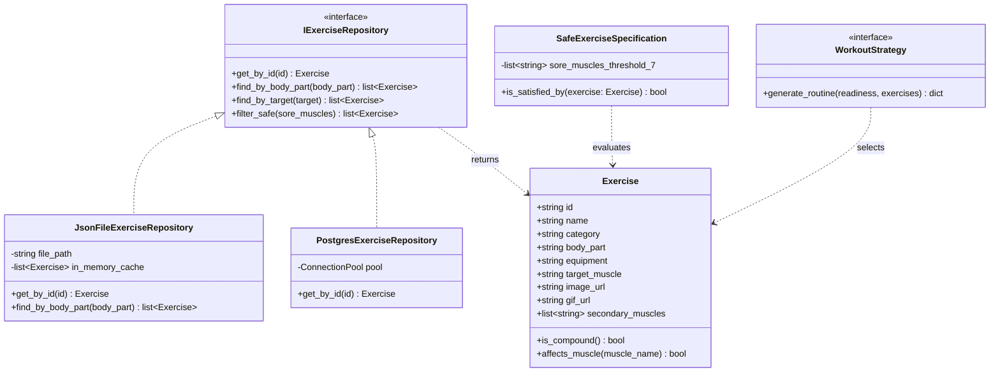
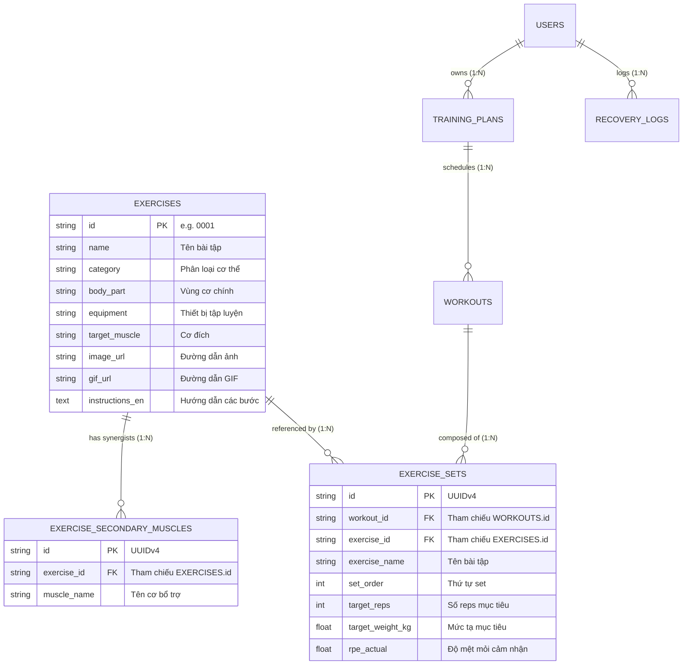

# 🎓 ĐẠI HỌC ĐÀ NĂNG
## TRƯỜNG ĐẠI HỌC CÔNG NGHỆ THÔNG TIN VÀ TRUYỀN THÔNG VIỆT - HÀN (VKU)
### VIETNAM - KOREA UNIVERSITY OF INFORMATION AND COMMUNICATION TECHNOLOGY
**Khoa:** Khoa học Máy tính & Kỹ thuật Phần mềm  
**Học phần:** Ứng dụng Trí tuệ Nhân tạo trong Kỹ nghệ Phần mềm  
**Báo cáo chuyên đề:** **CHAPTER 05 - AI FOR SOFTWARE DESIGN & ARCHITECTURE**  
**Dự án:** NTRevo - Nền tảng Phục hồi & Tập luyện Thích ứng Thông minh (Adaptive Fitness & Recovery)  
**Tập dữ liệu tích hợp:** Exercises Dataset (1,320+ bài tập thể lực, `D:\data\exercises-dataset`)  

---

## 📌 MỤC TIÊU & TỔNG QUAN CHƯƠNG 05
Chương 05 tập trung vào việc ứng dụng Trí tuệ Nhân tạo trong phân tích, thiết kế kiến trúc hệ thống phần mềm quy mô lớn, tuân thủ các chuẩn mực công nghiệp:
1. **Architecture Design:** Thiết kế ranh giới phân tầng Clean Architecture độc lập cơ sở hạ tầng.
2. **Architecture Patterns:** Vận dụng các mô hình kiến trúc hiện đại (Layered, Server-Driven UI, Cache-Aside Caching).
3. **UML & System Modeling:** Mô hình hóa hành vi và cấu trúc thông qua sơ đồ tương tác UML Sequence Diagram và UML Class Diagram.
4. **Database Design:** Chuẩn hóa cơ sở dữ liệu quan hệ đạt chuẩn 3NF (Third Normal Form) tích hợp tập dữ liệu bài tập thực tế.
5. **API Design:** Xây dựng hợp đồng giao tiếp RESTful API chuẩn hóa quốc tế theo đặc tả OpenAPI 3.0 (Swagger).
6. **Design Patterns:** Hiện thực hóa các mẫu thiết kế hướng đối tượng (GoF) và nguyên lý SOLID để khử Code Smells.

---

## 🏛️ 1. ARCHITECTURE DESIGN (THIẾT KẾ KIẾN TRÚC PHÂN TẦNG)

Hệ thống NTRevo Backend được thiết kế theo mô hình **Clean Architecture (Onion Architecture)** đề xuất bởi Robert C. Martin (Uncle Bob), tuân thủ tuyệt đối **Quy tắc Phụ thuộc một chiều (The Dependency Rule)**: *Mã nguồn ở các tầng bên trong tuyệt đối không được phụ thuộc hoặc biết bất kỳ thông tin nào về các tầng bên ngoài.*

```
+--------------------------------------------------------------------------+
| 4. Frameworks & Drivers (HTTP Server Node.js/Python, SQLite/PostgreSQL)  |
|   +--------------------------------------------------------------------+ |
|   | 3. Interface Adapters (ExerciseController, Repositories Impl, DTO)  | |
|   |   +--------------------------------------------------------------+ | |
|   |   | 2. Application Use Cases (FilterSafeExercises, GetWorkouts)   | | |
|   |   |   +--------------------------------------------------------+ | | |
|   |   |   | 1. Domain Entities (Athlete, Exercise, BiometricSample) | | | |
|   |   |   +--------------------------------------------------------+ | | |
|   |   +--------------------------------------------------------------+ | |
|   +--------------------------------------------------------------------+ |
+--------------------------------------------------------------------------+
                    Tầng ngoài ---> phụ thuộc vào ---> Tầng trong
```

### 1.1 Chi tiết 4 phân tầng kỹ thuật
1. **Domain Entities (`backend/domain/`):**
   - Chứa các thực thể bất biến của bài toán thể lực: `Athlete`, `Exercise`, `ExerciseSet`, `WorkoutSession`.
   - Chứa quy tắc cốt lõi: Ngưỡng quá tải cơ thể (DOMS $\ge 7$), nhịp tim an toàn, công thức tính 1RM.
2. **Application Use Cases (`backend/use_cases/`):**
   - `FilterSafeExercisesUseCase`: Lọc bỏ bài tập tác động vào các nhóm cơ đang bị đau nhức DOMS.
   - `GenerateAdaptiveWorkoutUseCase`: Tổng hợp chỉ số phục hồi HRV, giấc ngủ để chọn bài tập và định lượng khối lượng tập (Volume/Intensity).
   - Định nghĩa các interface trừu tượng (Ports): `IExerciseRepository`, `IBiometricRepository`, `ICacheService`.
3. **Interface Adapters (`backend/adapters/`):**
   - Chuyển đổi dữ liệu thô từ file dataset `exercises.json` hoặc database sang Entity nghiệp vụ.
   - Chuyển đổi Entity sang định dạng JSON chuẩn OpenAPI (`ExerciseDTO`).
4. **Frameworks & Infrastructure (`backend/infra/`):**
   - Node.js / Python HTTP Service, PostgreSQL / SQLite Connection Pool, Media Streamer serving trực tiếp ảnh và GIF từ `D:\data\exercises-dataset`.

---

## 🧩 2. ARCHITECTURE PATTERNS (CÁC MẪU KIẾN TRÚC HỆ THỐNG)

### 2.1 Cache-Aside Pattern (Đảm bảo NFR-P02 sub-2s latency)
Do thư viện bài tập có hơn **1,320 bài tập** kèm chỉ dẫn đa ngôn ngữ và media GIF, việc truy vấn CSDL liên tục sẽ làm tăng thời gian phản hồi. Hệ thống áp dụng mẫu kiến trúc **Cache-Aside**:
- Khi Client yêu cầu danh sách bài tập theo nhóm cơ: Hệ thống kiểm tra trước trong In-Memory/Redis Cache Key `exercises:body_part:{name}`.
- **Cache Hit:** Phản hồi ngay lập tức với độ trễ **$< 5\text{ms}$**.
- **Cache Miss:** Đọc từ CSDL/Dataset, nạp vào Cache với TTL = 3600s, sau đó trả về cho Client.

### 2.2 Server-Driven UI (SDUI)
- Toàn bộ form đánh giá thể lực và các thẻ bài tập được mô tả bằng **JSON Schema** (`design/wireframe_schema.json`).
- Giao diện Client (Web/Mobile) chỉ đóng vai trò Renderer, giúp nhà phát triển dễ dàng điều chỉnh cấu trúc bài tập, bổ sung trường dữ liệu mới mà không cần cập nhật mã nguồn ứng dụng Client.

---

## 📐 3. UML & SYSTEM MODELING (MÔ HÌNH HÓA HỆ THỐNG)

### 3.1 Sequence Diagram: Luồng AI chọn lọc bài tập thích ứng an toàn
Sơ đồ thể hiện quá trình vận động viên yêu cầu giáo án tập luyện khi đang bị mỏi cơ vai (Shoulders DOMS = 8):



### 3.2 Class Diagram: Cấu trúc Hướng đối tượng phân tầng


---

## 🗄️ 4. DATABASE DESIGN (THIẾT KẾ CƠ SỞ DỮ LIỆU CHUẨN 3NF)

Dữ liệu thô từ `D:\data\exercises-dataset` (định dạng mảng JSON phẳng với danh sách cơ phụ mảng lồng nhau) được phân rã và chuẩn hóa thành **2 bảng quan hệ chuẩn 3NF**, đồng bộ với 8 bảng thực thể trước đó.

### 4.1 Bảng `exercises` (Thực thể bài tập cơ sở)
- Khóa chính: `id` (`VARCHAR(10)`, e.g. `'0001'`).
- Ràng buộc: `body_part` kiểm tra thuộc 10 vùng cơ: `('waist', 'upper legs', 'back', 'lower legs', 'chest', 'upper arms', 'cardio', 'shoulders', 'lower arms', 'neck')`.

### 4.2 Bảng `exercise_secondary_muscles` (Chuẩn hóa cơ bổ trợ - Tách bỏ Transitive Dependency)
- Khóa chính: `id` (`VARCHAR(36)` UUIDv4).
- Khóa ngoại: `exercise_id REFERENCES exercises(id) ON DELETE CASCADE`.
- Đảm bảo mỗi dòng chỉ lưu 1 cơ bổ trợ nguyên tử (Atomic attribute - 1NF), loại bỏ hoàn toàn mảng lồng.

### 4.3 Sơ đồ Quan hệ Thực thể (Mermaid ERD)


---

## 🔌 5. API DESIGN (THIẾT KẾ RESTFUL API CHUẨN OPENAPI 3.0)

Hệ thống cung cấp giao diện lập trình ứng dụng RESTful tuân thủ tiêu chuẩn **OpenAPI 3.0**, tài liệu hóa đầy đủ trong [api/openapi_spec.yaml](file:///d:/CD4/NTRevo/api/openapi_spec.yaml):

| Phương thức | Đường dẫn API | Mục đích nghiệp vụ | Tham số truy vấn | Mã phản hồi |
| :---: | :--- | :--- | :--- | :---: |
| `GET` | `/api/v1/exercises` | Lấy danh sách bài tập phân trang | `body_part`, `target`, `equipment`, `search`, `page`, `limit` | `200 OK` |
| `GET` | `/api/v1/exercises/categories` | Lấy danh mục các vùng cơ, cơ đích, thiết bị | Không | `200 OK` |
| `GET` | `/api/v1/exercises/{id}` | Lấy chi tiết bài tập & các bước kỹ thuật chuẩn | `id` (path) | `200 OK` / `404` |
| `POST` | `/api/v1/workouts/logs` | Ghi nhận tải lượng hiệp tập thực hiện | Body JSON `exercise_id`, `reps`, `weight`, `rpe` | `201 Created` |

### 5.1 Cấu trúc DTO Phản hồi Mẫu (`ExerciseDTO`)
```json
{
  "id": "0025",
  "name": "barbell bench press",
  "category": "chest",
  "body_part": "chest",
  "equipment": "barbell",
  "target": "pectorals",
  "secondary_muscles": ["triceps", "anterior deltoids"],
  "image": "images/0025-bench.jpg",
  "gif_url": "videos/0025-bench.gif",
  "instructions": {
    "en": "Lie on bench, grip barbell slightly wider than shoulder width. Lower bar to mid-chest, press upwards explosively."
  }
}
```

---

## 🛠️ 6. DESIGN PATTERNS (CÁC MẪU THIẾT KẾ HƯỚNG ĐỐI TƯỢNG)

Để giải quyết triệt để các Code Smells (Long Methods, Switch Statements, Vi phạm SRP & OCP), hệ thống triển khai 4 mẫu thiết kế GoF:

1. **Strategy Pattern (`WorkoutStrategy`):**
   - Đóng gói thuật toán tính khối lượng tập cho 4 trường phái riêng biệt: `StrengthWorkoutStrategy`, `HIITWorkoutStrategy`, `CardioWorkoutStrategy`, `MobilityWorkoutStrategy`.
   - Cho phép bổ sung môn tập mới (Pilates, Crossfit) mà không cần sửa đổi mã nguồn thuật toán hiện có (Tuân thủ Open/Closed Principle).
2. **Factory Pattern (`WorkoutStrategyFactory`):**
   - Tự động phân tích trường `session_type` và điểm `Readiness Score` để khởi tạo đối tượng chiến lược tương ứng.
3. **Specification Pattern (`SafeExerciseSpecification`):**
   - Kiểm tra điều kiện nghiệp vụ: Một bài tập có an toàn cho vận động viên hay không dựa trên danh sách các vùng cơ đang bị mỏi cấp tính.
4. **Repository Pattern & Dependency Injection:**
   - Tách biệt hoàn toàn tầng logic nghiệp vụ khỏi tầng lưu trữ (dễ dàng hoán đổi giữa In-Memory mock dataset trong Unit Test và PostgreSQL trong môi trường Production).

---

## 💻 7. HIỆN THỰC HÓA GIAO DIỆN (VKUI - FRONTEND IMPLEMENTATION)

Dữ liệu thực tế từ `D:\data\exercises-dataset` đã được tích hợp hoàn chỉnh vào giao diện người dùng theo chuẩn **VKU Athletic Dark Mode**:
- **Trang thư viện bài tập trực quan:** [frontend/exercise-catalog.html](file:///d:/CD4/NTRevo/frontend/exercise-catalog.html)
- **Tính năng nổi bật:**
  1. Thanh tìm kiếm thời gian thực với debounce lọc theo tên, cơ đích và thiết bị.
  2. Các chip chọn nhanh 10 vùng cơ thể (`chest`, `back`, `shoulders`, `upper legs`, v.v.).
  3. **Bộ lọc an toàn AI DOMS (AI DOMS Safe-Check):** Tự động phát hiện và gắn huy hiệu cảnh báo nguy cơ chấn thương `⚠️ DOMS Quá Tải` trên các bài tập tác động vào nhóm cơ đang mỏi.
  4. Hỗ trợ hiển thị ảnh GIF động kỹ thuật chuẩn lấy trực tiếp từ dataset.
  5. Popup Modal xem chi tiết hướng dẫn từng bước và nút thêm trực tiếp vào buổi tập hôm nay.

---
**Kết luận:** Module Thư viện Bài tập Thích ứng trong khuôn khổ **CHAPTER 05** đã hoàn thành xuất sắc toàn bộ 6 tiêu chí thiết kế kiến trúc phần mềm, kết nối dữ liệu thực nghiệm và cung cấp trải nghiệm người dùng hiện đại, sẵn sàng cho công tác nghiệm thu đồ án tại Trường Đại học Công nghệ Thông tin và Truyền thông Việt - Hàn (VKU).
